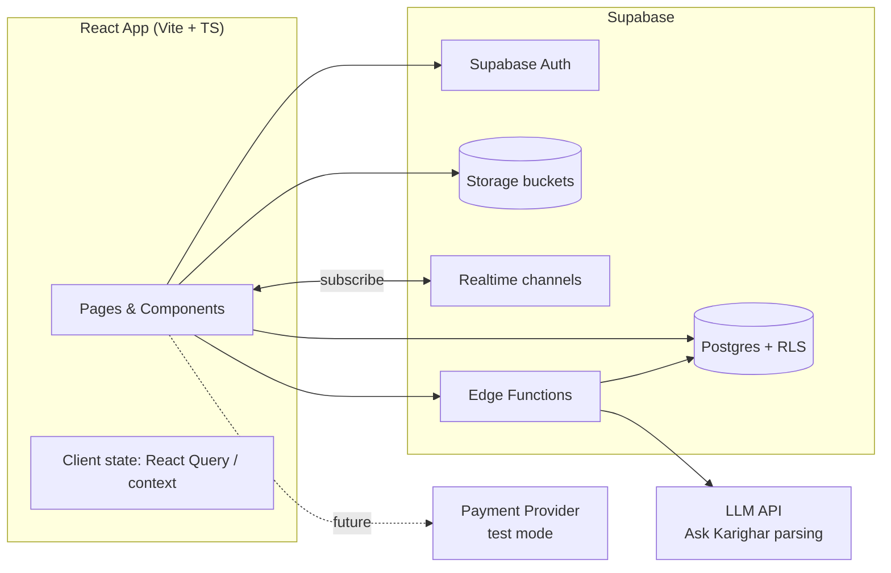
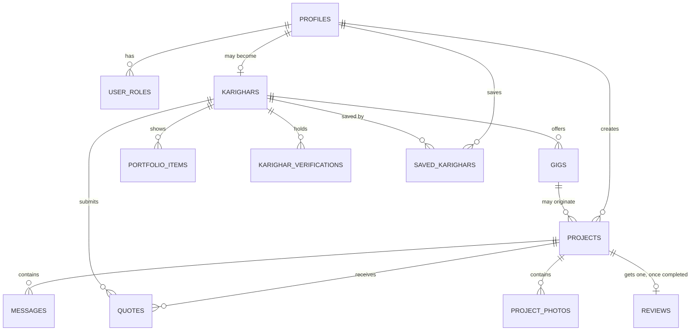
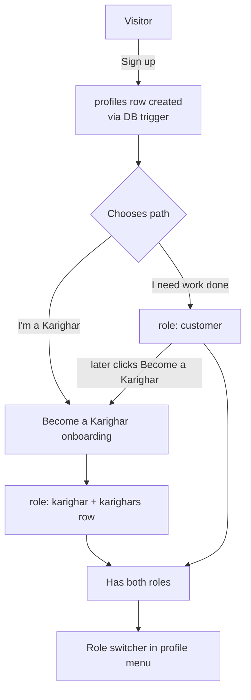
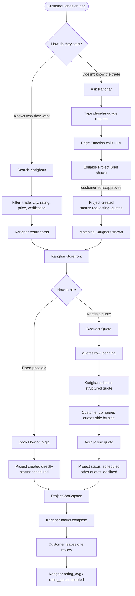
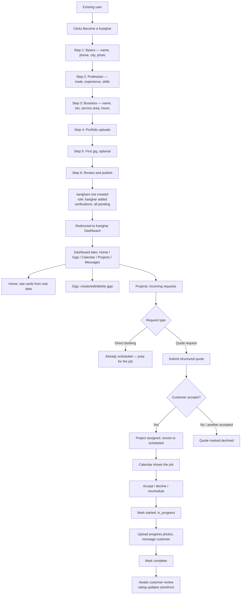
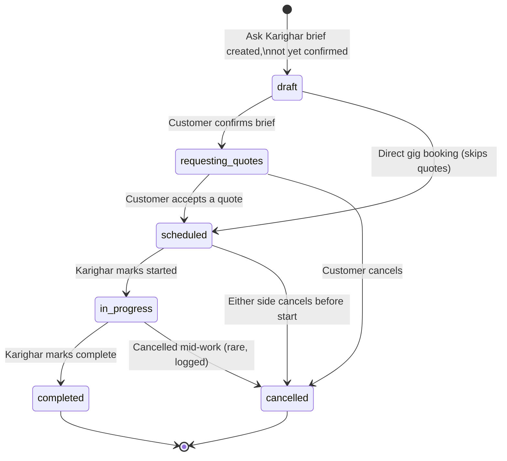
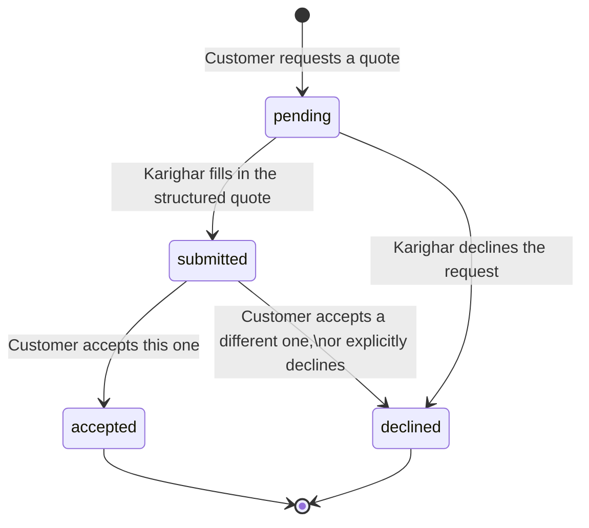
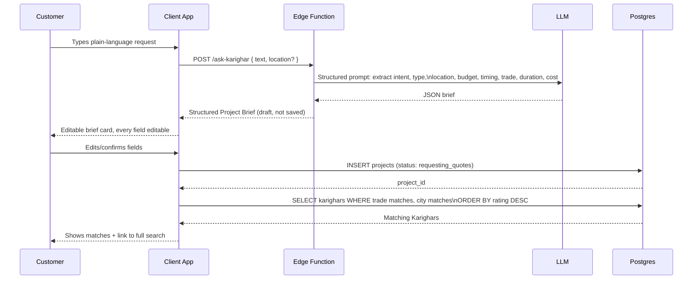

# Karighar — Architecture & Flow (Draft)

This is a technical companion to `karighar-blueprint.md`. That document is
the *why* and *what*. This document is the *how it actually behaves* —
system architecture, data relationships, state machines, and step-by-step
flows for every major journey in the app. Nothing here is a build
instruction; it's the shared mental model to build from.

---

## 1. System Architecture (high level)

**Principle:** the client never talks to the LLM or holds secrets. All AI
calls and anything requiring a secret key route through a Supabase Edge
Function. The client talks to Postgres directly only through RLS-protected
queries — RLS is the real authorization boundary, not the UI.

---

## 2. Core Objects & Relationships

**Why the Project sits at the center:** every other object (quotes,
messages, photos, review) points back to a Project, never to a Karighar
or Gig directly. That's what lets a two-hour repair and a six-week
renovation share the same system — the Project is the one object that
persists and accumulates history. Karighars and Gigs are discovery and
identity; Projects are where the actual work and trust record lives.

---

## 3. Roles & Auth Flow

A single `profiles` row per user. Roles are additive, not exclusive — a
person can be a customer, become a Karighar later, and remain both.

Session rule: protected routes check auth state before render; an
unauthenticated user hitting a protected route is redirected to sign-in
and returned to the original destination after success — never dropped on
a generic home page.

---

## 4. Customer Flow — Two Entry Paths (always both visible)

---

## 5. Karighar (Professional) Flow

---

## 6. Project Status — State Machine

**Who can trigger which transition:**
| Transition | Who | Notes |
|---|---|---|
| draft → requesting_quotes | Customer | Confirms the AI brief |
| draft → scheduled | Customer | Only via direct gig "Book Now" |
| requesting_quotes → scheduled | Customer | Accepting a quote; other quotes auto-decline |
| → cancelled | Either, with reason | Logged, visible in project history |
| scheduled → in_progress | Karighar | Marks arrival/start |
| in_progress → completed | Karighar | Customer is prompted to review afterward |

---

## 7. Quote Lifecycle

Accepting one quote is a single transaction: set that quote to `accepted`,
set all sibling quotes on the same Project to `declined`, and move the
Project to `scheduled`.

---

## 8. Ask Karighar — Request Flow in Detail

**Failure handling:** if the LLM call fails, fall back to a simple
keyword-based parser so the flow never dead-ends.

---

## 9. Messaging & Realtime

Each Project has exactly one message thread. A user only subscribes to
Realtime channels for Projects they're a participant in (enforced by RLS).

---

## 10. Screen / Route Map

| Route | Who | Purpose |
|---|---|---|
| `/` | Everyone | Landing: hero, dual search, Build/Renovate/Fix, featured Karighars |
| `/search` | Everyone | Search Karighars results, filters, sort |
| `/ask` | Everyone | Ask Karighar input → editable brief → matches |
| `/karighar/:id` | Everyone | Karighar storefront: bio, portfolio, reviews, badges, gigs |
| `/gig/:id` | Everyone | Gig detail, Book Now / Request Quote |
| `/project/:id` | Customer + assigned Karighar only | Project Workspace |
| `/my-projects` | Customer | List of customer's own projects |
| `/saved` | Customer | Saved Karighars |
| `/become-a-karighar` | Signed-in user | Multi-step onboarding |
| `/dashboard` | Karighar | Home: stat cards, alerts |
| `/dashboard/gigs` | Karighar | Gigs CRUD |
| `/dashboard/calendar` | Karighar | Day/week/month view |
| `/dashboard/projects` | Karighar | Incoming requests, active jobs |
| `/dashboard/messages` | Karighar | Cross-project message inbox |
| `/settings` | Signed-in user | Profile edit, role switcher |
| `/sign-in`, `/sign-up`, `/reset-password` | Visitor | Auth |
| `*` | Everyone | 404 |

---

## 11. What This Draft Deliberately Leaves Open

Scope of Work approval, Change Orders, Resolution Center, Warranty
tracking, payments/payout state, and Business/Contractor mode with
multi-worker assignment are not designed yet. Those belong in Part 2 once
Phase 1's flow is validated in the live app.
